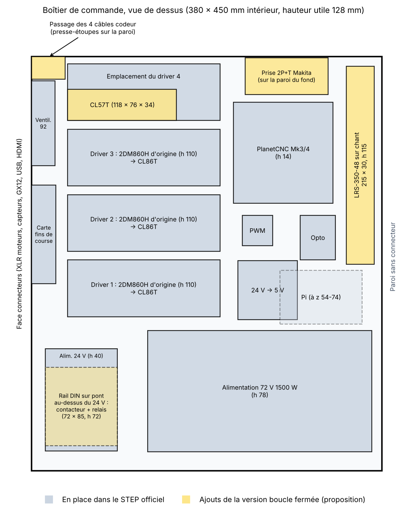

# Boîtier de commande : les ajouts de la boucle fermée tiennent-ils ?

Le boîtier d'origine est dessiné pour 4 drivers 2DM860H et deux alimentations (72 V et 24 V).
La version chiffrée ici ajoute une alimentation 48 V, remplace les drivers et ajoute une coupure de puissance.
Cette page vérifie la place disponible, à partir des volumes relevés dans `cad/source/FAB-CU V1.0.stp`.

**Conclusion : tout tient, sans modifier les tôles avant la découpe.** Les perçages supplémentaires se font à la main, pièces en main (voir plus bas).

## Ce qui est mesuré et ce qui ne l'est pas

- **Mesuré dans le STEP :** l'intérieur du boîtier (380 × 450 mm, 128 mm de hauteur utile), la position et l'encombrement de chaque composant d'origine, les perçages de la tôle.
- **Non vérifié :** les dimensions des pièces ajoutées. Elles sont données de mémoire d'après les catalogues, et les fiches techniques n'étaient pas consultables depuis cette session. **À confirmer sur chaque fiche avant de percer.**

## Place disponible

| Zone libre | Dimensions | Remarque |
|---|---|---|
| Bande le long de la paroi sans connecteur | 50 × 290 mm, toute la hauteur | Le Raspberry Pi la surplombe sur les 60 premiers millimètres |
| Au-dessus de l'alimentation 24 V | 78 × 111 mm, 88 mm de haut | Près de l'entrée secteur |
| Coin entre le ventilateur et la paroi du fond | 35 × 24 mm | Libre du sol au capot |
| Emplacement du 4e driver | 165 × 62 mm, 110 mm de haut | Libéré en partie par le CL57T, plus petit |

## Implantation proposée

| Ajout | Encombrement (à confirmer) | Emplacement | Marge |
|---|---|---|---|
| 3 drivers CL86T | environ 151 × 97 × 53 mm | à la place des 2DM860H 1 à 3 | même gabarit annoncé ; entraxe des trous de fixation à comparer aux 142 mm de la tôle |
| Driver CL57T (axe Z) | environ 118 × 76 × 34 mm | emplacement du 4e driver | large ; 2 trous à percer |
| Alimentation LRS-350-48 | 215 × 115 × 30 mm | sur chant dans la bande libre, bornes côté Pi | 30 mm dans 50 mm de large, 115 mm dans 128 mm de haut |
| Prise 2P+T de la Makita | environ Ø45, 40 mm de profondeur | paroi du fond, derrière le PlanetCNC | 46 mm libres entre la carte et la paroi |
| Module relais 5 V et bouton marche | petits | module près du rail DIN, bouton Ø22 sur la face connecteurs ou la paroi du fond | — |
| Contacteur 25 A et relais 25 A sur rail DIN | environ 72 × 85 mm, 72 mm de haut rail compris | sur un petit pont au-dessus de l'alimentation 24 V | 72 dans 78 mm, 85 dans 111 mm, 72 dans 88 mm de haut |
| 4 câbles codeur | câbles de Ø6 environ | 4 presse-étoupes dans la paroi du fond, côté face connecteurs | à côté du ventilateur |

### Points d'attention

- **L'alimentation 48 V passe près des borniers du PlanetCNC** : il reste une quinzaine de millimètres pour les fils. Câbler la carte avant de fixer l'alimentation.
- **Refroidissement :** la LRS-350 a son propre ventilateur. Le ventilateur du boîtier souffle sur les drivers ; ne pas boucher ses ouïes avec le pont du rail DIN.
- **Le pont du rail DIN** est une pièce à faire : une tôle pliée en U ou deux entretoises M4 de 45 mm et une plaque. Elle n'est ni dessinée ni chiffrée.
- **Câbles codeur :** les kits StepperOnline se branchent sur le driver par un bornier, avec un câble à fils nus. Il n'y a donc pas besoin d'embases en façade : des presse-étoupes suffisent. À confirmer à la réception des kits.
- **Si le contacteur ne tient pas** une fois les pièces en main : il reste la solution d'un boîtier séparé (le boîtier VFD d'origine), au prix d'une liaison secteur entre les deux boîtiers.

## Perçages à faire à la main

La tôle fait 1,5 mm : elle se perce sans difficulté après la découpe. Il vaut mieux percer avec les pièces réelles comme gabarit que d'ajouter au STEP des trous placés d'après une fiche.

| Perçage | Nombre | Où |
|---|---:|---|
| Ø4,5 pour le CL57T | 2 | fond du boîtier |
| Ø4,5 pour la LRS-350-48 (trous taraudés M4 de son flanc) | 2 | fond du boîtier |
| Ø4,5 pour le pont du rail DIN | 2 à 4 | fond du boîtier, autour de l'alimentation 24 V |
| Ø16 environ pour presse-étoupes PG9 | 4 | paroi du fond, près du ventilateur |
| Découpe de la prise 2P+T (scie cloche, diamètre selon la prise) | 1 | paroi du fond |
| Ø22 pour le bouton marche | 1 | au choix |
| Trous des CL86T, seulement si leur entraxe diffère de 142 mm | jusqu'à 6 | fond du boîtier |

Ébavurer et protéger les trous de la rouille : la tôle est brute.
