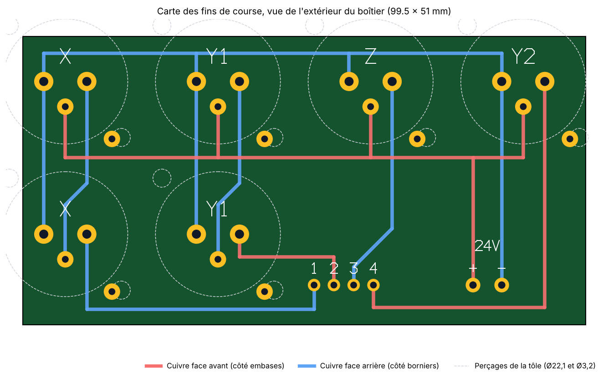

# Carte des fins de course

Mekanika ne publie que le schéma de cette carte (`upstream/fab/docs/PCB-limits.qet`, QElectroTech), pas de Gerber.
Elle est redessinée ici à partir du schéma et des perçages de la tôle du boîtier.

- **Fichiers de fabrication :** [`cad/pcb-fins-de-course/fab-fins-de-course-gerber.zip`](../cad/pcb-fins-de-course/)
- **Générateur :** `scripts/make_limits_pcb.py` (il vérifie les isolements et la continuité avant d'écrire les fichiers)

**État : dessinée et vérifiée par le script, pas encore fabriquée ni essayée.** Lire « À vérifier avant de commander ».

## Ce que fait la carte

La carte est **passive** : aucun composant actif, seulement 6 embases XLR, 2 borniers et des pistes.
L'optocoupleur du schéma est un module séparé (M00712), placé entre la carte et le contrôleur.

- Elle distribue le 24 V et le 0 V aux 6 capteurs inductifs (PNP, normalement fermés).
- Elle met **en série** les deux capteurs X, et les deux capteurs Y1 : la sortie du premier alimente le second. Si l'un des deux s'ouvre, la sortie tombe à 0.
- Elle ramène 4 signaux vers le contrôleur : X, Y1, Z, Y2.

Comme les deux embases d'un même axe sont en série, on peut brancher X− et X+ dans l'une ou l'autre : le schéma d'origine le précise.

### Brochage des embases XLR (vue de face, loquet en haut)

| Broche | Position | Rôle | Fil du capteur LJ12A3 |
|---|---|---|---|
| 1 | à droite | sortie du capteur | noir |
| 2 | à gauche | 0 V | bleu |
| 3 | en bas | alimentation du capteur | brun |

Les couleurs sont celles du standard des capteurs 3 fils : à confirmer sur l'étiquette du capteur reçu.

### Équipotentielles

| Net | Relie |
|---|---|
| 0 V | broche 2 des 6 embases, borne « − » |
| +24 V | broche 3 des 4 embases du haut, borne « + » |
| X série | broche 1 de l'embase X du haut → broche 3 de l'embase X du bas |
| Y1 série | broche 1 de l'embase Y1 du haut → broche 3 de l'embase Y1 du bas |
| Sortie 1 | broche 1 de l'embase X du bas |
| Sortie 2 | broche 1 de l'embase Y1 du bas |
| Sortie 3 | broche 1 de l'embase Z |
| Sortie 4 | broche 1 de l'embase Y2 |

## Câblage dans le boîtier

Relevé dans `upstream/fab/docs/Control Unit FAB.qet` :

| Carte | Va vers |
|---|---|
| « + » et « − » | alimentation 24 V du boîtier |
| Sorties 1, 2, 3, 4 | entrées In1 à In4 du module optocoupleur |
| Sorties V1 à V4 de l'optocoupleur | entrées LIM1 à LIM4 du contrôleur PlanetCNC |
| G de l'optocoupleur, côté sortie | GND du contrôleur |

- **Masse côté entrée de l'optocoupleur :** le schéma d'origine ne la montre pas reliée. Elle doit aller au 0 V du 24 V, sinon le courant des capteurs ne se referme pas.
- **Module optocoupleur :** prendre la version à entrées **24 V**. La version 3,3/5 V a des résistances trop faibles pour du 24 V.
- **Logique :** capteur au repos = sortie à 24 V = optocoupleur passant = entrée LIM tirée à la masse. Un fil coupé ou un capteur débranché se voit donc comme un fin de course atteint. Régler la polarité des entrées dans PlanetCNC en conséquence.

## Mécanique

Entraxes relevés dans `cad/steel/fab-cu/step/Fab_Control_Unit_Base_v50_Base_t1.5mm_x1.step` :

- 6 perçages de Ø22,1 mm au pas de **27 mm** : 4 en haut, 2 en bas ;
- 2 trous de fixation de Ø3,2 mm par embase, en diagonale à ±9,9 mm de l'axe.

Vue de l'extérieur du boîtier, la rangée du haut porte X, Y1, Z, Y2 de gauche à droite. La rangée du bas porte X et Y1, sous les deux premières. C'est la disposition de la page « Back Side » du schéma.

La carte fait **99,5 × 51 mm**, en 2 couches. Les embases sont sur la face avant (vers la tôle), les borniers se soudent sur la face arrière (vers l'intérieur du boîtier). Les 6 embases vissées à la tôle tiennent la carte : il n'y a pas d'autre fixation.

## Composants

| Réf. | Composant | Qté | Remarque |
|---|---|---:|---|
| M00917 | Embase Neutrik **NC3FAV** (XLR 3 femelle, CI vertical) | 6 | Sans contact de masse. NC3FAV2 convient aussi : un trou isolé est prévu pour son contact de masse |
| M00790 | Bornier à vis 2 pôles, pas 5,08 mm | 1 | Trous de 1,3 mm |
| M00791 | Bornier à ressort 4 pôles, pas 3,5 mm | 1 | Trous de 1,2 mm |
| M00714 | Circuit imprimé | 1 | Lot de 5 chez JLCPCB, 1,6 mm, options par défaut |

**Ne pas prendre de NC3FAV1 ni de NC3FAV1-0.** Ces variantes relient la broche 1 au corps de la fiche et à la face avant, donc au châssis. Or la broche 1 porte le signal du capteur : les 4 sorties seraient en court-circuit avec la tôle. La BOM désignait une NC3FAV1-0 ; elle est corrigée.

## À vérifier avant de commander

1. **Sens des embases.** L'empreinte vient de la bibliothèque KiCad (`Connector_Audio`, série NC3FAV). La carte suppose le loquet en haut, avec les trous de fixation en haut à gauche et en bas à droite vus de l'extérieur, ce qui correspond à la tôle. Je n'ai pas pu consulter la fiche Neutrik depuis cette session. Avec une embase en main, loquet en haut et vue de face : vérifier que les broches 1 et 2 sont à la même hauteur, écartées de 7,62 mm, que la broche 3 est 4,45 mm plus bas, et que les oreilles de fixation sont en haut à gauche et en bas à droite. Si la broche 3 est en haut, la carte est à refaire tournée de 180°.
2. **Ouvrir le zip dans une visionneuse Gerber** (celle de JLCPCB à l'import, ou gerbv) et comparer avec l'aperçu ci-dessus. Les fichiers sont écrits par un script maison, pas par un logiciel de CAO.
3. **Borniers :** vérifier le pas et le diamètre des broches des modèles achetés.
4. **Sérigraphie :** la face arrière porte les repères 1 à 4, « + », « − » et le nom des axes.

## Sans circuit imprimé

La carte ne contient que des fils. Une plaque à pastilles ne convient pas (les broches des embases ne sont pas au pas de 2,54 mm), mais on peut câbler en volant 6 embases XLR à cosses à souder (NC3FD-L-1) en suivant le tableau des équipotentielles. Il faut alors des trous de Ø24 mm au lieu de Ø22,1 dans la tôle.
