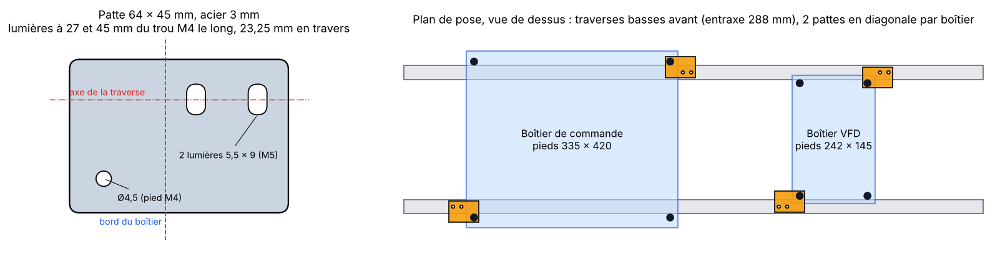

# Pièces acier : correspondance nomenclature ↔ fichiers

Généré par `scripts/extract_steel.py` à partir des STEP officiels (dossier `cad/source/`).
Les fichiers sont dans `cad/steel/<assemblage>/dxf/` (découpe 2D) et `.../step/` (3D, une pièce par fichier).
Aperçu de tous les DXF : [`cad/steel/preview.png`](../cad/steel/preview.png).

La **nuance d'acier n'est pas indiquée** dans le dépôt (S235 par défaut, à confirmer avec Mekanika ou sur Discord).

## Plaques plates (DXF prêts pour la découpe laser ou jet d'eau)

| Réf. BOM | Pièce (nomenclature) | Nom dans le STEP | Ép. | Qté | Dimensions | Fichier |
|---|---|---|---|---|---|---|
| M00284 | Y gantry | Gantry_V2 v25 | 10 mm | 2 | 432 × 300 | `fab/dxf/Gantry_V2_v25_t10mm_x2.dxf` |
| M00285 | Y gantry back plate | Gantry back plate v12 | 8 mm | 1 | 550 × 200 | `fab/dxf/Gantry_back_plate_v12_t8mm_x1.dxf` |
| M00283 | R&P drive plate | Rack & Pinion drive plate_04 | 8 mm | 2 | 286 × 152 | `fab/dxf/Rack_Pinion_drive_plate_04_v21_t8mm_x2.dxf` |
| M00281 | Gusset plate | Triangulation v6 | 8 mm | **14** (12 dans la BOM) | 394 × 30 | `fab/dxf/Triangulation_v6_t8mm_x14.dxf` |
| M00282 | Limit sensor support plate | Limit switches support 02 v15 | 8 mm | 4 | 80 × 120 | `fab/dxf/Limit_switches_support_02_v15_t8mm_x4.dxf` |
| M00354 | Nut Offset | Nut Offset bracket v2 | 8 mm | 2 | 52 × 40 | `fab/dxf/Nut_Offset_bracket_v2_t8mm_x2.dxf` |
| M00364 | Bearing Support Offset Plate | Bearing Support Offset Plate v7 | 3 mm | 2 | 42 × 42 | `fab/dxf/Bearing_Support_Offset_Plate_v7_t3mm_x2.dxf` |
| M00361 | Z Plate *(probable)* | Fab XL - Z_plate v4 | 8 mm | 1 | 160 × 190 | `fab/dxf/Fab_XL_Z_plate_v4_t8mm_x1.dxf` |
| M00360 | X Nut *(probable)* | Fab XL - X_Bearing blocks & nuts v10 | 8 mm | 1 | 178 × 240 | `fab/dxf/Fab_XL_X_Bearing_blocks_nuts_v10_t8mm_x1.dxf` |
| M00359 | Z-axis Top Motor Plate | Fab XL - X_Motor Z v1 | 8 mm | 1 | 160 × 73 | `fab/dxf/Fab_XL_X_Motor_Z_v1_t8mm_x1.dxf` |
| M00358 | Z-Axis Bottom Bearing Plate | Fab XL - X_Bearing Z v1 | 8 mm | 1 | 130 × 65 | `fab/dxf/Fab_XL_X_Bearing_Z_v1_t8mm_x1.dxf` |
| — | *(absente de la BOM)* support de broche | Spindle plate | 8 mm | 1 | 118 × 110 | `fab/dxf/Spindle_plate_t8mm_x1.dxf` |
| M00488 | End connection plate 30x60 *(pièce achetée)* | Foot Plate 3060 M6 v2 | 10 mm | 6 | 60 × 30 | `fab/dxf/Foot_Plate_3060_M6_v2_t10mm_x6.dxf` |
| M01379 | CU-VFD Mounting plate *(facultative, redessinée : voir plus bas)* | — | 3 mm | 0 à 4 | 64 × 45 | `diy/CU_VFD_Mounting_plate_DIY_t3mm_x4.dxf` |

## Tôles pliées (STEP 3D à envoyer tel quel)

Les découpeurs en ligne de tôlerie acceptent le STEP 3D et calculent eux-mêmes le développé.
Pour faire le développé soi-même : atelier *SheetMetal* de FreeCAD (gratuit) ou *Flat Pattern* dans Fusion.

| Réf. BOM | Pièce | Ép. | Qté | Fichier |
|---|---|---|---|---|
| M00278 | Cable chain holder | 3 mm | 4 | `fab/step/Cable_chain_support_02_v4_Component1_t3mm_x4.step` |
| M00279 | Control Unit Base | 1,5 mm | 1 | `fab-cu/step/Fab_Control_Unit_Base_v50_Base_t1.5mm_x1.step` |
| M00280 | Control Unit Cover | 1,5 mm | 1 | `fab-cu/step/Fab_Control_Unit_Cover_v14_Cover_t1.5mm_x1.step` |
| M00355 | VFD Base *(reportée, voir plus bas)* | 1,5 mm | 1 | `vfd-cu/step/VFD_Enclosure_Base_v26_Base_t1.5mm_x1.step` |
| M00356 | VFD Cover *(reportée)* | 1,5 mm | 1 | `vfd-cu/step/VFD_Enclosure_Cover_v5_Cover_t1.5mm_x1.step` |

## À savoir avant de commander

- **Écarts à lever :**
  - ~~**Goussets**~~ : **levé, 14.** La nomenclature en donne 12, mais les 14 du STEP sont tous utiles (positions dans [verifications.md](verifications.md), section 5).
  - ~~**CU-VFD Mounting plate 3 mm ×4 (M01379)**~~ : **levé.** Ces pattes servent au nouveau montage du boîtier ; avec ce châssis, le boîtier se pose sans patte. Voir « Fixation des boîtiers » plus bas.
  - **Spindle plate :** présente dans le STEP mais pas dans la nomenclature de la Fab, car elle est vendue avec la broche.
- **Pièces symétriques :** la *drive plate* gauche et la droite ont la même géométrie. On découpe 2 fois le même DXF et on retourne une des deux pièces au montage.
- **Logo :** la *Gantry back plate* contient le logo MEKANIKA découpé, vu en miroir dans le DXF (il se lit à l'endroit sur l'autre face). C'est leur marque : à garder pour un usage perso, à retirer si tu publies ou vends ton dérivé.
- **Diamètres des trous** (relevés dans les DXF) :
  - **Passages de vis :** Ø4,5 (M4), Ø5,5 (M5), Ø6,5 (M6), Ø8,5 (M8).
  - **Trous probablement taraudés, à vérifier sur le modèle 3D :**
    - Z plate : 8 × Ø5,04, soit un perçage de taraudage M6.
    - Gantry : 1 × Ø10,2, soit un perçage de taraudage M12.
    - Drive plate : 4 × Ø4,3, soit un perçage de taraudage M5.
- **Petits trous dans les plaques épaisses :** en découpe laser, on vise un Ø au moins égal à l'épaisseur. Les Ø4,3 et Ø4,5 dans de l'acier de 8 mm sont à faire **pointer au laser puis percer**, ou à percer soi-même. Demander au découpeur.
- **Regroupement par épaisseur** (utile pour les devis) :
  - **8 mm :** 28 pièces, dont 14 goussets.
  - **10 mm :** 2 gantries, plus 6 plaques de pied si on ne les achète pas.
  - **3 mm :** 2 plaques plates + 4 pliées.
  - **1,5 mm :** 2 capots pliés pour le boîtier de commande ; 2 de plus pour le boîtier VFD, reportés.

## Fixation des boîtiers et pattes (M01379)

**En bref : les boîtiers se posent à plat sur les deux traverses basses avant, sans patte.** C'est le montage que le guide officiel décrit pour ce châssis. Les pattes sont facultatives.

### Ce que dit le guide officiel

Le guide (chapitre « Machine Connection ») décrit deux montages, selon la date de la machine :

| | Ancien montage | Nouveau montage (depuis mars 2026) |
|---|---|---|
| Position du boîtier | à plat, à l'avant gauche, « bien calé entre les 2 profilés bas » | à la verticale, suspendu à un profilé placé à 500 mm de haut |
| Fixation | aucune | 4 pattes à encoche en acier de 3 mm (2 par boîtier), 10 vis M5×12, 2 pieds en caoutchouc en butée |
| Châssis | 3 traverses basses | 2 traverses basses et un « support du boîtier » |

Les 4 « CU-VFD Mounting plate » de la nomenclature sont les pattes du nouveau montage. Leur géométrie n'est publiée nulle part (ni STEP, ni DXF) : on ne les voit que sur les photos du guide.

**Ce projet suit l'ancien montage**, celui du modèle 3D (voir [verifications.md](verifications.md), section 9). Il n'a donc pas besoin de ces pattes.

### Ce que montrent les STEP

Les deux traverses basses avant (30×60 de 1410 mm, à Y = −1262 et −974) sont à **288 mm d'entraxe**. Cet écart correspond aux pieds des deux boîtiers :

| Boîtier | Entraxe des pieds M4 | Position par rapport aux traverses |
|---|---|---|
| Commande | 335 × 420 mm | 335 − 17 = 318 mm = largeur hors tout des deux traverses : les pieds les encadrent **par l'extérieur** |
| VFD | 242 × 145 mm | 242 + 17 = 259 mm pour 258 mm entre les traverses : les pieds se logent **à l'intérieur** |

Les pieds en caoutchouc font Ø17 mm : ce sont eux qui calent le boîtier, d'où le « bien calé » du guide.

### Patte de blocage facultative

Si tu veux visser le boîtier au lieu de le laisser simplement posé (machine déplacée, vibrations), une patte est dessinée dans `cad/steel/diy/`. Ce n'est pas la pièce d'origine.

- Plaque de 64 × 45 mm, acier 3 mm, avec 1 trou Ø4,5 et 2 lumières de 5,5 × 9 mm.
- Elle se glisse entre le fond du boîtier et le pied en caoutchouc, et se visse par deux M5×12 dans la rainure du dessus de la traverse, au-delà du bord du boîtier.
- Le trou de pied tombe à 23,5 mm de l'axe de la traverse pour le boîtier de commande et à 23,0 mm pour le VFD : une seule patte sert aux deux.
- Deux pattes par boîtier, en diagonale, suffisent.

Elle n'est ni dans la BOM ni dans le dossier de devis (environ 10 € les 4). Génération : `.venv/bin/python scripts/make_cu_bracket.py`.

### À vérifier

- Diamètre réel des pieds en caoutchouc achetés : au-delà de Ø17, ils ne passent plus de part et d'autre des traverses.
