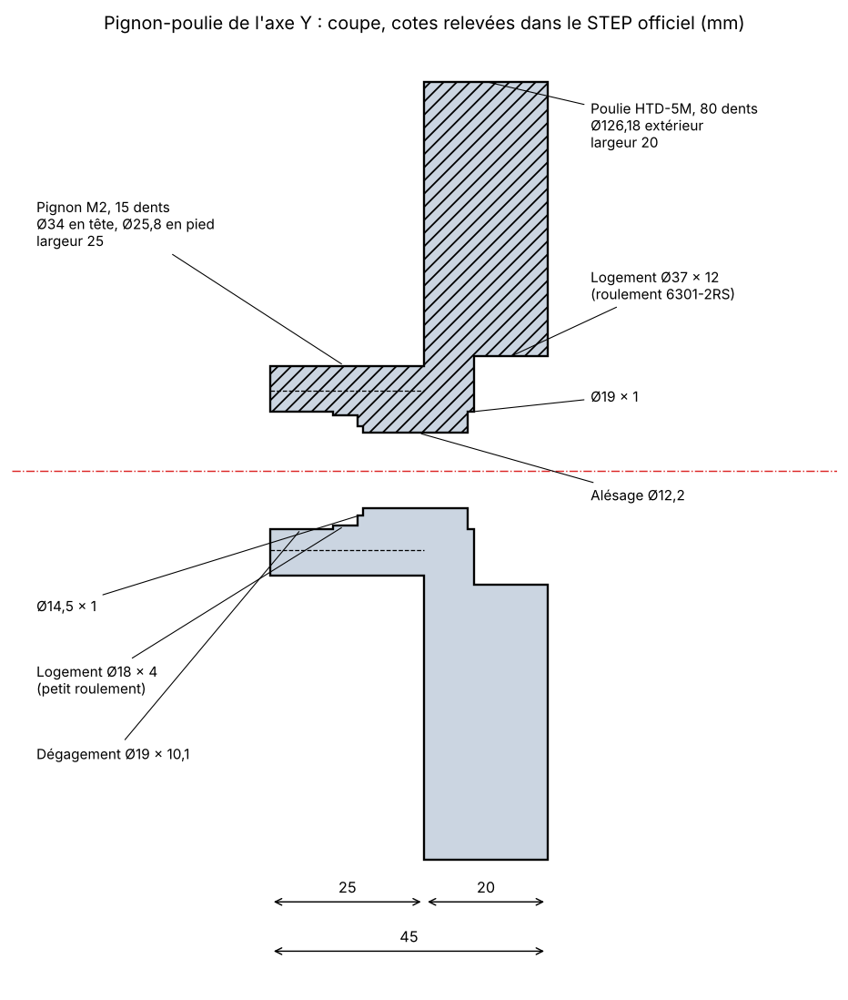

# Pignon-poulie de l'axe Y : fiche pour l'atelier

Il en faut **2, identiques**. C'est une pièce spéciale Mekanika (M01685), introuvable toute faite.
Cette fiche donne les cotes relevées dans le STEP officiel, pour faire fabriquer ou assembler la pièce.

## Cotes relevées dans le STEP

| Élément | Cote |
|---|---|
| Longueur totale | 45 mm |
| **Pignon** | module 2, **15 dents**, Ø34 en tête, Ø25,8 en pied, largeur 25 mm |
| **Poulie** | HTD-5M, **80 dents**, Ø126,18 extérieur, largeur 20 mm, sans flasque |
| Alésage central | Ø12,2 (la pièce tourne librement sur un axe fixe de Ø12) |
| Logement côté poulie | Ø37 × 12 mm de profondeur |
| Logement côté pignon | Ø18 × 4 mm, au fond d'un dégagement de Ø19 × 10,1 mm |

La pièce ne transmet aucun couple à un arbre : la courroie entraîne la poulie, le pignon solidaire roule sur la crémaillère, et l'ensemble tourne fou sur une vis à épaulement M10 de Ø12 × 50 (ISO 7379), fixée dans la plaque d'entraînement.

Réduction : poulie moteur de 20 dents, soit **4:1**. Le diamètre primitif du pignon est de 30 mm : un tour de pignon fait avancer le portique de 94,25 mm.

## Deux versions de la pièce

Le STEP publié et le guide de montage ne décrivent pas la même version. Seuls les alésages changent : la denture, la poulie et la longueur sont identiques.

| | STEP publié (« Q5_03 v6 ») | Guide et nomenclature (« Pinion v2 ») |
|---|---|---|
| Côté poulie | logement Ø37 × 12 → 6301-2RS (12 × 37 × 12) | le même |
| Côté pignon | logement Ø18 × 4 → roulement 12 × 18 × 4 | roulement **6801-ZZ, 12 × 21 × 5** |
| Entre les deux roulements | alésage de Ø12,2 | entretoise C de 12 × 18 × 18, qui passe dans l'alésage |
| Montage | cotes complètes, mesurées | ordre d'empilage décrit dans le guide ([notes-de-montage.md](notes-de-montage.md)) |

**Version retenue : celle du guide (v2).** C'est elle que la nomenclature, la BOM et le guide de montage décrivent, et ses bagues intérieures sont serrées en un seul empilage, ce qui est le montage correct de deux roulements sur un axe fixe.

### Alésages de la version v2

Ces cotes sont **déduites de l'empilage** du guide (3 + 5 + 18 + 12 + 8 mm sur une vis à épaulement de 50 mm) et de la longueur de la pièce. Elles ne sont pas mesurées sur une pièce réelle : à faire valider par l'atelier, roulements et entretoises en main.

| En partant du bout du pignon | Diamètre | Longueur |
|---|---|---|
| Dégagement pour la tête de vis et l'entretoise A | Ø21,5 environ | 10 mm |
| Logement du roulement 6801 | Ø21 H7 | 5 mm |
| Passage de l'entretoise C (Ø18) | Ø19 | 18 mm |
| Logement du roulement 6301 | Ø37 H7 | 12 mm |

Total : 10 + 5 + 18 + 12 = 45 mm, la longueur de la pièce.

**Point de vigilance :** sous les dents du pignon (pied à Ø25,8), il ne reste que 2,4 mm de matière autour du logement de Ø21. C'est le choix de Mekanika pour la v2, mais dans un pignon du commerce en C45 non trempé, l'atelier peut préférer la version du STEP (logement de Ø18, 3,9 mm de matière), avec un roulement 12 × 18 × 4 à la place du 6801.

## Deux façons de l'obtenir

1. **Assemblage, comme chiffré (~70 € par ensemble).** Un pignon M2 Z15 du commerce (Dold, C45, largeur 20) et une poulie HTD-5M 80 dents du commerce, usinés puis assemblés : alésages et logements ci-dessus, pignon emmanché, collé et goupillé dans la poulie.
   - Le pignon du commerce fait 20 mm de large au lieu de 25 : vérifier avec l'atelier que la denture reste en face de la crémaillère (24 mm de large).
   - Le pignon C45 n'est pas trempé : c'est une pièce d'usure, à surveiller.
2. **Pièce monobloc sur plan**, taillée par un atelier d'engrenages. Plus cher, mais conforme à l'original, et on peut demander une denture trempée.

## À donner à l'atelier

- cette fiche et le dessin (il montre les alésages de la version du STEP) ;
- une vis à épaulement ISO 7379 Ø12 × 50 M10, les deux roulements et les trois entretoises, pour ajuster les logements ;
- la tolérance attendue : logements de roulements en H7, concentricité de la denture du pignon par rapport aux logements meilleure que 0,05 mm. C'est elle qui fait la régularité de l'axe Y.

## Poulies moteur

Pour mémoire, les poulies côté moteur (M00733) sont des HTD-5M de 20 dents : Ø30,69 extérieur, flasques de Ø36, 17 mm entre flasques, 26 mm de long. L'original a un alésage de 12,7 mm ; cette version les prend en alésage 14 H7 avec une rainure de clavette de 5 mm, pour les arbres Ø14 clavetés des moteurs en boucle fermée.
