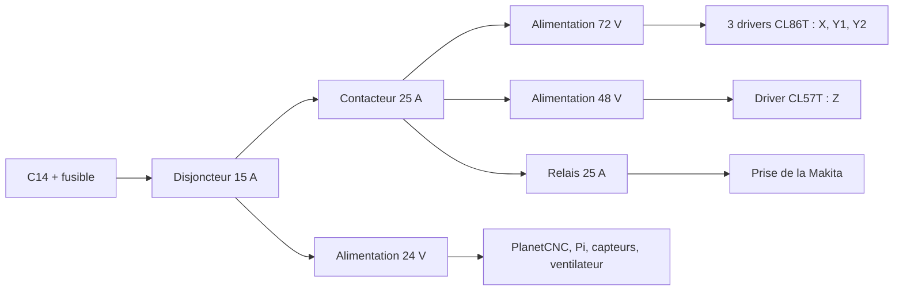

# Plan de câblage

Deux parties :

1. **Le câblage d'origine**, relevé fil par fil dans les schémas officiels (`upstream/fab/docs/Control Unit FAB.qet` et `VFD unit.qet`).
2. **Ce que change cette version** : moteurs en boucle fermée, alimentation 48 V, coupure de puissance câblée, Makita à la place de la broche.

La partie 1 est lue dans les schémas. La partie 2 est une proposition : elle contient des **décisions à prendre** et des points à confirmer sur les notices, listés à la fin. Rien de tout cela n'a été câblé ni essayé.

> Le secteur 230 V est mortel. Si tu n'as pas l'habitude de câbler une armoire, fais relire la partie puissance par quelqu'un qui l'a.

## 1. Câblage d'origine

### Secteur et alimentations

| De | Vers |
|---|---|
| Embase C14, phase | fusible → interrupteur (L1 → T1) → L des alimentations 72 V et 24 V |
| Embase C14, neutre | interrupteur (L2 → T2) → N des deux alimentations |
| Embase C14, terre | terre des deux alimentations, tôle du boîtier, douille banane de mise à la terre |
| Alimentation 72 V, + et − | V+ et GND des 4 drivers |
| Alimentation 72 V, − | corps des 4 embases XLR moteur |
| Alimentation 24 V | ventilateur, carte des fins de course, PlanetCNC (+24V, GND), carte PWM (VCC), convertisseur 24 V → 5 V |
| Convertisseur 24 V → 5 V | USB-C du Raspberry Pi |

### Contrôleur vers drivers

Les drivers sont câblés en **cathode commune** : PUL−, DIR− et ENA− sont reliés ensemble au GND du connecteur d'axe ; les signaux arrivent sur PUL+, DIR+ et ENA+.

| Connecteur du PlanetCNC | Driver | Moteur |
|---|---|---|
| Axis 1 (STEP, DIR, ENA, GND) | driver du bas du schéma | X *(probable)* |
| Axis 2 | 3e driver | Y1 *(probable)* |
| Axis 3 | 2e driver, nommé « Z » dans le schéma | **Z** |
| Axis 4 | 1er driver | Y2 *(probable)* |

Seul l'axe Z est nommé dans le schéma. L'attribution de X, Y1 et Y2 suit l'usage (le 4e axe est l'esclave de Y) : à confirmer dans la configuration PlanetCNC de Mekanika ou sur le Discord.

Les sorties d'alarme des drivers (ALM+, ALM−) ne sont pas câblées dans l'original.

### Drivers vers moteurs (embases XLR 4 broches)

| Borne du driver | Broche XLR 4 |
|---|---|
| A+ | 2 |
| A− | 1 |
| B+ | 3 |
| B− | 4 |
| *(corps de l'embase)* | − de l'alimentation 72 V |

Câbles moteur d'origine : X 340 cm, Y1 340 cm, Y2 530 cm, Z 570 cm.

### Fins de course

Voir [carte-fins-de-course.md](carte-fins-de-course.md). En résumé :

| Carte des fins de course | Optocoupleur | PlanetCNC |
|---|---|---|
| Sortie 1 (les 2 capteurs X en série) | In1 → V1 | LIM1 |
| Sortie 2 (les 2 capteurs Y1 en série) | In2 → V2 | LIM2 |
| Sortie 3 (Z) | In3 → V3 | LIM3 |
| Sortie 4 (Y2) | In4 → V4 | LIM4 |
| | G côté sortie | GND |

Câbles capteurs d'origine : Y1− 180 cm, Y2− 270 cm, Y1+ 330 cm, X− 350 cm, X+ 530 cm, Z+ 580 cm.

### Entrées et sorties en façade (connecteurs GX12)

| Connecteur | Broche | Va vers |
|---|---|---|
| Arrêt d'urgence (2 broches) | 1 | GND du PlanetCNC |
| | 2 | entrée E-Stop du PlanetCNC, et broche 3 du connecteur laser |
| Palpeur Z (3 broches) | 1 | GND |
| | 2 | IN1 |
| | 3 | **+5 V** |
| Input 2 (2 broches) | 1 / 2 | IN2 / GND |
| Input 3 (2 broches) | 1 / 2 | IN3 / GND |
| Commande VFD (5 broches) | 1 | libre |
| | 2 | GND de la carte PWM |
| | 3 | sortie 0-10 V de la carte PWM (consigne de vitesse) |
| | 4 | OUT1 (marche broche) |
| | 5 | +5 V |
| Commande laser (5 broches) | 1 | OUT6, relié aussi à l'entrée PWM de la carte PWM |
| | 2 | GND |
| | 3 | ligne d'arrêt d'urgence |
| | 4 | OUT2 |

IN4 est libre. Le PlanetCNC est relié au Raspberry Pi par son port USB-B.

### Boîtier VFD d'origine

| De | Vers |
|---|---|
| C14 avec filtre → interrupteur → disjoncteur 10 A | entrées R et S du variateur |
| Variateur U, V, W | embase Speakon vers la broche ; terre sur la 4e broche |
| GX12 broche 2 | ACM du variateur et masse du module relais 5 V |
| GX12 broche 3 | VI du variateur (consigne 0-10 V) |
| GX12 broche 4 | entrée IN du module relais |
| GX12 broche 5 | alimentation 5 V du module relais |
| Contact du module relais (COM, NO) | DCM et FOR du variateur (marche avant) |

## 2. Ce que change cette version

### Chaîne de puissance

- **Le 24 V reste hors contacteur** : après un arrêt d'urgence, le contrôleur, le Pi et les capteurs restent alimentés et la position est gardée.
- **Auto-maintien du contacteur :** la bobine est alimentée à travers le contact NF n° 1 de l'arrêt d'urgence, puis le bouton marche (NO) en parallèle avec un contact auxiliaire NO du contacteur. Après une coupure, rien ne repart sans appui sur le bouton marche.
- **Contact NF n° 2 de l'arrêt d'urgence :** vers l'entrée E-Stop du PlanetCNC, par le connecteur GX12 2 broches d'origine.

### Drivers en boucle fermée

| Liaison | Câblage |
|---|---|
| Signaux STEP, DIR, ENA | comme l'original, en cathode commune sur les mêmes connecteurs d'axe |
| Puissance des 3 CL86T | alimentation 72 V, comme l'original |
| Puissance du CL57T | alimentation **48 V** séparée. Ne jamais le relier au 72 V |
| Moteurs | comme l'original, par les XLR 4 broches : A+, A−, B+, B− |
| Codeurs | câble du kit + rallonge, jusqu'au bornier codeur de chaque driver, par presse-étoupe (voir [boitier-commande.md](boitier-commande.md)) |
| Alarmes | les 4 sorties ALM en parallèle sur **IN4**, retour au GND |

- **Rallonges codeur :** Y2 et Z ont des câbles moteur de 5,3 et 5,7 m ; prendre des rallonges de 5 m en plus des 1,7 m du kit. Les faire passer dans les chaînes avec les câbles moteur, blindage relié d'un seul côté, au boîtier.
- **Alarme :** c'est le gain principal de la boucle fermée sur un portique à deux moteurs. Si un driver décroche, la machine s'arrête au lieu de se mettre en travers.

### Makita et boîtier relais

| De | Vers |
|---|---|
| Sortie du contacteur (boîtier de commande) | entrée secteur du boîtier relais |
| Entrée secteur du boîtier relais | contact du relais 25 A → prise 2P+T de la Makita |
| GX12 « Commande VFD » broche 4 (OUT1) et broche 5 (+5 V) | module relais 5 V, comme l'original |
| GX12 broche 1, libre dans l'original | **+24 V**, pour la bobine du relais 25 A |
| GX12 broche 2 | masse commune |
| Contact du module relais 5 V | coupe le +24 V de la bobine du relais 25 A |

La broche 3 (consigne 0-10 V) ne sert pas avec la Makita. Elle reste câblée pour le jour où la broche 2,2 kW remplace l'affleureuse.

## 3. Décisions à prendre

1. **Tension de la bobine du contacteur.** Le budget prévoit une bobine 230 V. Le bouton d'arrêt d'urgence est déporté au bout d'un câble : avec une bobine 230 V, **ce câble et son connecteur portent le secteur**, et le GX12 2 broches d'origine n'est pas fait pour ça. Je recommande un contacteur à **bobine 24 V CC**, alimenté par le 24 V du boîtier : le câble de l'arrêt d'urgence reste en très basse tension. Même prix à peu près, référence à changer dans la BOM.
2. **Connecteur de l'arrêt d'urgence.** Avec 2 contacts NF, il faut 4 conducteurs : soit un second GX12 2 broches (les connecteurs « Input 2 » et « Input 3 » sont libres), soit un GX12 4 broches à la place de celui d'origine.
3. **Liaison de puissance vers le boîtier relais.** Le secteur commuté doit sortir du boîtier de commande : une embase de sortie (C13 de façade) ou un cordon par presse-étoupe. Aucune des deux n'est dans la BOM. L'autre solution est de mettre le relais 25 A et la prise de la Makita dans le boîtier de commande, et de se passer du boîtier relais tant qu'il n'y a pas de VFD.
4. **Bouton marche :** sur le boîtier de commande ou à côté de l'arrêt d'urgence. Le second est plus pratique, mais ajoute 2 conducteurs au câble.

## 4. À confirmer sur les notices

- **Palpeur Z :** l'original l'alimente en **5 V**. Celui de la BOM est annoncé « 24 V, 3 fils ». Vérifier qu'il fonctionne en 5 V, ou l'alimenter en 24 V et s'assurer que sa sortie ne renvoie pas 24 V sur IN1.
- **Bornes des CL86T et CL57T :** noms et ordre des bornes codeur, et type de la sortie alarme (ouverte ou fermée au repos, réglable sur certains modèles). Le câblage en parallèle suppose une sortie qui se ferme en cas de défaut ; si elle s'ouvre, il faut câbler les 4 en série.
- **Entrées du PlanetCNC :** niveau actif de IN4 et de E-Stop, et type des sorties OUT1 (peut-elle commander directement le module relais ?).
- **Attribution des axes** X, Y1, Y2 sur Axis 1, 2 et 4.
- **Sections :** 1,5 mm² pour le secteur et le 72 V jusqu'aux drivers, 2,5 mm² entre contacteur, relais et prise de la Makita, 0,25 à 0,5 mm² pour les signaux. Embouts sertis sur tous les fils souples.
