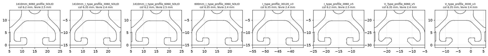
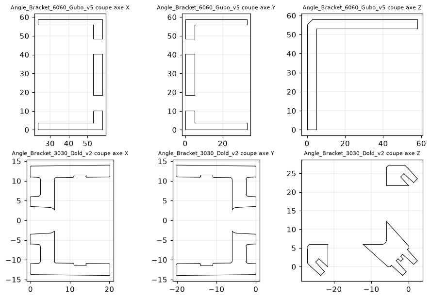

# Vérifications dans le STEP officiel (8 novembre 2026)

Mesures faites directement sur la géométrie de `cad/source/FAB V1.0.stp` (OpenCascade).
Objectif : confirmer que les références chiffrées dans `bom/chiffrage/` vont réellement sur la machine.

## 1. Rainures des profilés : tout est en rainure 6

Chaque profilé est coupé à mi-longueur, puis la rainure est mesurée à plusieurs profondeurs.

| Profilé (nom dans le STEP) | Section | Entrée en surface | **Col (ouverture mini)** | Lèvre |
|---|---|---|---|---|
| 1410mm I-type profile 6060 / 1410mm 6060 profile | 60×60 | 8,2 mm (chanfrein 1 mm) | **6,2 mm** | 2,5 mm |
| I-type profile 3060 (1410 et 600) | 30×60 | 8,2–8,35 mm | **6,2–6,35 mm** | 2,4–2,5 mm |
| I-type profile 30120 | 30×120 | 8,35 mm | **6,35 mm** | 2,4 mm |
| V-Type profile 6060 (gantry, 1530) | 60×60 | 9,35 mm (chanfrein 45° « V ») | **6,35 mm** | 2,4 mm |
| V-type profile 3030 (chariot X, 240) | 30×30 | 9,35 mm | **6,35 mm** | 2,4 mm |

**Conclusions :**
- **Le 60×60 est bien en rainure 6.** Le « Groove 8 » de la nomenclature désigne la cornière, pas le profilé. Le chiffrage (Dold « I-Typ Nut 6 » partout, écrous coulissants Nut 6) est **correct**.
- **Profilés « V » :** les quatre profilés nommés « V » (2 × 60×60 du gantry, 2 × 30×30 du chariot X) ont seulement une entrée chanfreinée à 45°. Le col est le même 6,35 mm. **Aucune roue ne roule dessus** : les 4 roues V-slot sont dans les ensembles moteur-pignon de l'axe Y (2 par côté). Des profilés I standard conviennent, comme chiffré.

## 2. Cornières

- **Cornière 60×60 (« Gubo », 50 pièces dans le STEP) :** base plate **sans nez de centrage**, trous de Ø8,2. Elle se fixe avec vis M6 + rondelle large DIN9021 sur écrou coulissant rainure 6 : c'est pour ça que la nomenclature compte 276 rondelles M6×18. La cornière Dold 67250 « sans nez » retenue convient.
- **Cornière 30 (« Dold », 36 pièces dans le STEP) :** avec nez de centrage rainure 6. Le chiffrage (Dold art. 62378, I-Typ Nut 6) correspond à la pièce nommée dans le STEP.

## 3. Crémaillère : identique à la référence Dold chiffrée

| Cote | STEP officiel | Dold GG-445-020-0210 « mit Bohrbild » |
|---|---|---|
| Section × longueur | 24 × 24 × 1005,31 mm | 24 × 24 × 1005,31 mm |
| Module / dents | M2 (hauteur de dent 4,5 mm) | M2, 160 dents, ligne primitive h = 22 |
| Trous de fixation | Ø7 lamé Ø11, profondeur 7 | d1 = 7, d2 = 11, t = 7 |
| Position du 1er trou / entraxe | 62,8 mm puis tous les 125,66 mm (8 trous) | a = 62,83, l = 125,66 |
| Trous de goupille | Ø5,7 à 31,3 mm des bouts, 942,7 mm d'entraxe | d3 = 5,7, a1 = 31,3, l1 = 942,7 |

**Conclusion :** c'est exactement la même pièce. Le numéro fabricant 445-020-0210 est une référence **Mädler**, que Dold revend.
- **Variante à commander :** « L1=1000, **mit Bohrbild** », c'est-à-dire avec les perçages. Le lien de la BOM pointe bien vers elle.
- **Autre source possible :** Mädler en direct, prix non vérifié.
- **Variante économique :** des crémaillères moins chères devront reprendre cette section 24×24, ce perçage et la hauteur primitive de 22 mm. Sinon les plaques d'entraînement et les supports ne tombent plus en face.
